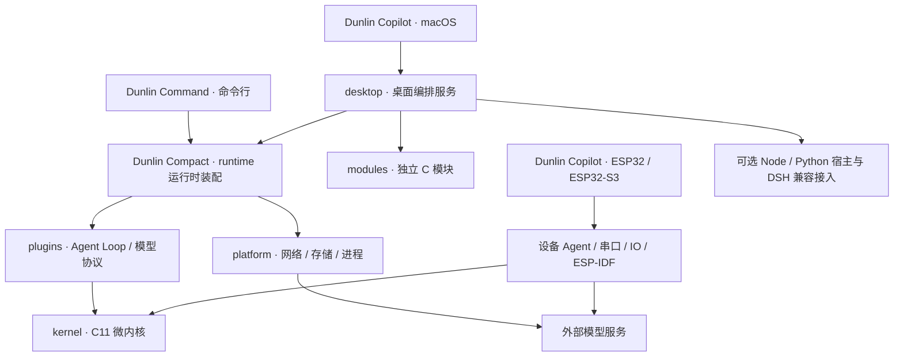

# Dunlin C

Dunlin C 受到 **DeepSeek Harness** 的启发。项目最初面向嵌入式系统移植：设备资源有限，需要控制内存开销，因此沿着模块化 Agent 的思路，使用codex自行搭建了一套基于 **C11** 的紧凑核心，并在此基础上逐步实现选定的 Harness 能力与兼容接入。

项目由共享核心 **Dunlin Compact**、命令行外壳 **Dunlin Command** 和分平台客户端 **Dunlin Copilot** 组成。模型推理由外部服务提供，设备端与桌面端按各自的资源条件组合能力。

## 项目架构

Dunlin Compact 将微内核、运行时装配、插件和平台能力分层。微内核负责上下文、作用域、服务、依赖和事件；Agent 循环与模型协议由插件提供；网络、存储和进程执行由平台层实现。

Dunlin Command 调用共享运行时，负责终端交互和审批呈现。Dunlin Copilot 的 macOS 客户端使用 SwiftUI 展示界面，项目、会话、工具记录等共享业务由 C 服务承载。ESP32 客户端复用同一份微内核，使用独立的设备 Agent 和板级适配，不装配完整桌面服务。

独立模块通过明确的 C API 供宿主组合；SwiftUI、解释器和板级业务不进入微内核。兼容接入位于独立边界内，按需启用。

## 目录索引

| 目录 | 内容 |
| --- | --- |
| `dunlin-compact/kernel/` | C11 微内核：上下文、作用域、服务、依赖与事件 |
| `dunlin-compact/runtime/` | 配置、运行时装配和共享调用入口 |
| `dunlin-compact/plugins/` | Agent Loop、模型协议及标准插件 |
| `dunlin-compact/platform/` | 网络传输、会话存储、工具执行和操作系统适配 |
| `dunlin-command/src/` | 命令行入口、终端交互、显示和审批策略 |
| `dunlin-copilot/macos/` | macOS 原生客户端、Xcode 工程和 SwiftUI 源码 |
| `dunlin-copilot/esp32/` | 设备 Agent、串口、IO、Python 适配与 ESP-IDF 板级工程 |
| `dunlin-copilot/linux/`、`dunlin-copilot/windows/` | 预留的原生客户端目录 |
| `dunlin-copilot/assets/` | 客户端共享图标资源 |
| `desktop/` | 桌面 C 编排、来源存储、项目与会话管理 |
| `modules/` | 可独立组合的身份、上下文、技能、知识、索引、附件、工具记录、轨迹与文件历史等 C 模块 |
| `include/` | 共享核心和独立模块的公共 C 接口 |
| `compat/dsh/` | 固定版本的 DeepSeek Harness 兼容环境与装配接入 |
| `hosts/` | 可选 Node / Python 扩展宿主 |
| `config/` | 运行时与模型配置样例 |
| `scripts/` | 构建、打包和验证入口 |
| `tests/` | 内核、运行时、协议、工具、宿主与设备回归 |
| `docs/` | 架构、接口、协议与平台说明；`assets/` 保存 README 横幅 |
| `vendor/` | 固定的第三方依赖源码 |
| `docker/` | 容器构建与运行环境 |
| `build/`、`dist/` | 构建中间文件与分平台产物 |
| `runtime-data/` | 本地运行数据 |

## 功能

| 功能层 | 当前能力 |
| --- | --- |
| 微内核 | Context / Scope、服务注册与依赖、插件生命周期、事件分发和可撤销资源 |
| Agent 运行时 | 模型与工具循环、参数校验、预算、取消、审批、检查点和会话恢复；外部效果不明时阻止自动重放 |
| 模型接入 | Chat Completions、Responses、Anthropic Messages、Ollama 与 Gemini 协议适配；各协议按已实现子集接入 |
| 工具 | 文件读写、命令与进程执行、计算及受限 HTTP 请求，结合宿主权限策略执行 |
| 命令行 | 单次任务、交互对话、显式续聊、多模型配置、结构化结果和执行事件 |
| 桌面 | 原生聊天与项目界面、模型配置、文件引用、工具记录、历史索引及可选扩展接入 |
| 独立模块 | 身份与上下文管理、技能快照、知识记录、附件存储、执行轨迹和文件历史；各模块按宿主组合接入 |
| 设备 | ESP32 / ESP32-S3 串口与板级 IO、远程模型调用和有界对话记忆；具体能力随目标固件组合 |
| Harness 兼容 | 固定版本的来源与行为对照，以及独立的可选宿主接入；逐步扩展兼容范围 |

项目仍在开发中。macOS 客户端的完整产品验收、多 Agent 协作、媒体能力和扩展完整生命周期尚有待完成；Linux / Windows 原生 GUI 目录目前预留。协议适配、组件测试和单个平台的实测分别对应各自范围，不代表完整 Harness 兼容或所有平台功能等价。

## 开发状态与插件清单

**音视频：TODO，暂未开发完成的试验性功能。** 当前保留实验代码和界面，真实设备、实时模型及回看效果后续再调试，不作为已完成的通话能力发布。

社区索引与项目维护清单参见 [商店与同步](docs/stores.md)。目录同步只更新列表，不执行远程安装命令；DSH 兼容范围仍按插件逐项验证。

## 开始使用

参见 [构建与开发](docs/build.md)、[商店与同步](docs/stores.md) 和 [第三方组件](THIRD_PARTY.md)。公开仓库仅包含整理后的代码、构建资源、测试源码和当前设计；不包含运行数据、私有配置及历史验收产物。
